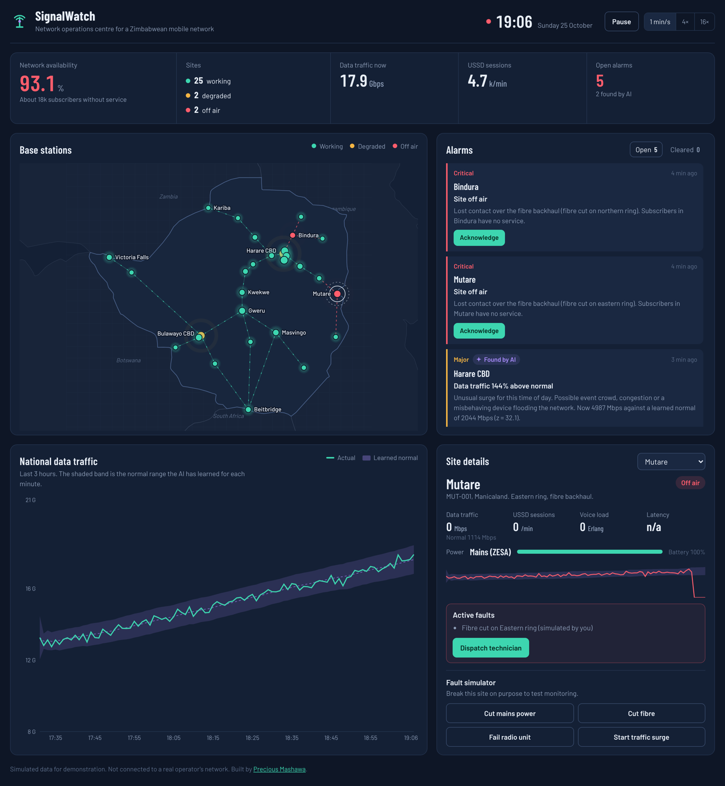

# SignalWatch: Network Operations Dashboard

A live network operations centre (NOC) dashboard for a Zimbabwean mobile network, built with **React and TypeScript**. It watches 29 base stations across the country, raises alarms when sites fail, and uses an **AI anomaly detector** to catch problems that fixed rules miss.

**Live demo:** https://preciousmashawa53-coder.github.io/signalwatch-noc/



## What it does

Every mobile operator runs a NOC: engineers watching towers, traffic and outages in real time. SignalWatch is a working model of one.

- **Live map of Zimbabwe.** 29 base stations from Victoria Falls to Mutare, connected by fibre and microwave backbone links. Towers glow green, amber or red, and traffic visibly flows along the links.
- **Real-time traffic.** Data, voice and USSD traffic follow realistic daily patterns, with an evening data peak and morning USSD rush.
- **AI anomaly detection.** Each site learns its own normal traffic for every minute of the day. When traffic moves far outside that range, the AI raises an alarm and explains it in plain language.
- **Alarm management.** Critical, major and minor alarms, sorted by severity. Operators can acknowledge alarms and dispatch technicians, and alarms clear automatically when the fault is fixed.
- **Realistic faults.** ZESA load-shedding (sites switch to batteries, which drain until the site goes off air), fibre cuts, radio unit failures and traffic surges.
- **Fault simulator.** Break any site on purpose and watch the network, the alarms and the AI react. A one-click outage demo runs three faults at once.

## How the AI works

Traffic changes a lot through the day, so comparing raw numbers would cause false alarms every evening. Instead, for each site the detector:

1. Divides live traffic by the expected daily pattern, giving a ratio that should stay close to the same value all day.
2. Learns the normal mean and spread of that ratio with an **exponentially weighted moving average (EWMA)**.
3. Converts every new reading to a **z-score**, which is how many standard deviations it is from normal.
4. Raises an anomaly when |z| ≥ 3.5 for **two readings in a row**, which filters out one-off spikes.
5. **Does not learn from anomalous readings**, so a long fault never becomes the new "normal".

In testing it raised **zero false alarms over a simulated 24 hours** of normal traffic, while catching radio failures within two minutes. A radio unit failure is a good example of why this matters: the site is still reachable, so simple up/down rules see nothing wrong, but the AI notices that traffic has collapsed.

The source is in [`src/sim/anomaly.ts`](src/sim/anomaly.ts).

## Tech stack

| Area | Tools |
| --- | --- |
| Front end | React 18, TypeScript, Vite |
| Charts | Recharts |
| Map | d3-geo with Natural Earth country outlines |
| Testing | Vitest, React Testing Library (17 tests) |
| CI/CD | GitHub Actions: lint, test, build and deploy to GitHub Pages on every push |

## Project structure

```
src/
├── App.tsx                 Page layout
├── components/             Map, alarm feed, charts, site panel, top bar
├── hooks/useNoc.ts         Runs the live simulation clock
├── sim/
│   ├── engine.ts           Network simulation, faults, alarms
│   ├── anomaly.ts          AI anomaly detector
│   ├── traffic.ts          Daily traffic patterns
│   └── random.ts           Seeded random numbers, so tests are repeatable
└── data/
    ├── sites.ts            Base stations and backbone links
    └── region.json         Map outlines for Zimbabwe and neighbours
```

The simulation is written as **pure functions** (`state → next state`), kept separate from the React components. This makes it easy to test and would make it easy to swap in a real data feed.

## Run it locally

You need [Node.js](https://nodejs.org) 20 or newer.

```bash
npm install
npm run dev      # start at http://localhost:5173
npm test         # run the tests
npm run build    # production build in dist/
```

## Ideas for next steps

- Connect to a real data source over WebSockets
- Store alarm history in a database and add reports on uptime per province
- Add SMS or WhatsApp notifications for critical alarms

## Note

All data is simulated for demonstration. SignalWatch is not connected to, or affiliated with, any real mobile operator.

## Author

**Precious Mashawa**, Software Engineering graduate, Harare, Zimbabwe
[Portfolio](https://preciousmashawa.co.zw) · [LinkedIn](https://www.linkedin.com/in/precious-mashawa/) · preciousmashawa53@gmail.com
